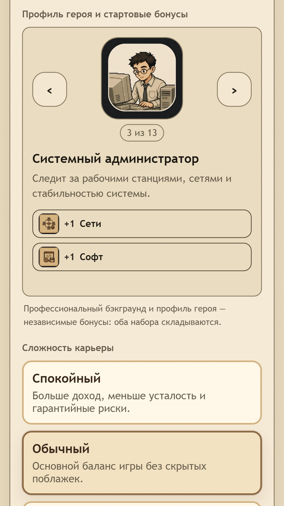
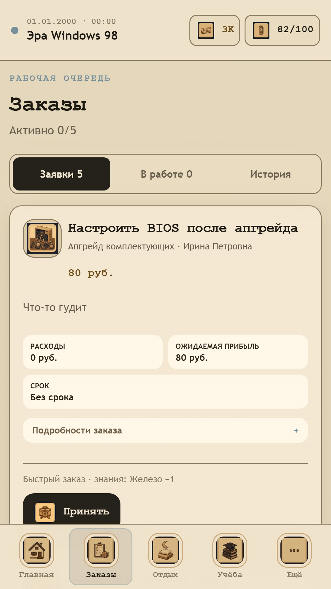
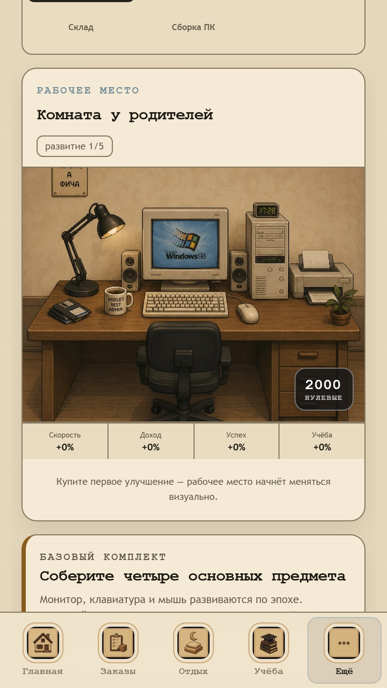

<div align="center">
  
  <h1>Хроники айтишника</h1>
  <p><strong>Офлайн-симулятор ремонта ПК и карьеры в 2000–2010 годах</strong></p>
  <p><a href="https://github.com/MarcoPolo54321/it-chronicles/releases/latest"><strong>Скачать APK для Android</strong></a> · <a href="docs/CHANGELOG.md">История версий</a> · <a href="media/rustore/README.md">Материалы для RuStore</a></p>
  <p>Android 6.0+ и браузер · русский язык · локальные сохранения</p>
</div>

Первый заказ приходит в 2000 году. На столе — старый ПК, коробка дискет и инструменты. Разберитесь, почему компьютер клиента не запускается, выберите способ ремонта и проверьте результат. Заработанные деньги можно вложить в оборудование и со временем открыть собственную мастерскую.

<div align="center">
  
  
  
</div>

## Что можно делать в игре

- **Брать заказы.** Диагностика, стратегия ремонта и контроль качества влияют на оплату, отзывы и гарантийные возвраты.
- **Развивать героя.** Профиль и профессиональный бэкграунд дают разные стартовые бонусы. Навыки растут с практикой и обучением.
- **Обустраивать мастерскую.** Покупайте комплектующие, собирайте ПК, улучшайте рабочее место и развивайте свой сервис.
- **Пройти кампанию до 2010 года.** После финала можно продолжить в свободном режиме или начать «Новую карьеру+».

## Установка на Android

Откройте [релиз v0.18.4](https://github.com/MarcoPolo54321/it-chronicles/releases/tag/v0.18.4) и скачайте `Hroniki-Aytishnika-v0.18.4-debug.apk` из раздела **Assets**. Это тестовая сборка с отладочной подписью. Прогресс хранится на устройстве, а перенос сохранения доступен в настройках игры.

В исходниках ветки `main` кнопка «Открыть» адаптирована к узким экранам, и весь интерфейс использует светлое оформление.

Если Android отклоняет установку поверх предыдущей версии из-за подписи, экспортируйте сохранение из установленной игры перед её удалением.

## Запуск из исходников

Для тестов и запуска через npm нужен Node.js 22 или новее.

```sh
npm test
npm run serve -- -l 8080
```

Откройте `http://localhost:8080`. Для запуска без npm можно раздать папку `www` командой `python -m http.server --bind 127.0.0.1 --directory www 8080`.

### Сборка Android

На Windows установите Node.js с npm, Android Studio с Android SDK и JDK 21. Запустите `BUILD_UPDATE.bat` из корня проекта. Скрипт установит зависимости по lock-файлу, синхронизирует ресурсы, прогонит тесты и положит тестовый APK в папку загрузок.

Для подписанной сборки подготовьте проект командой `powershell -NoProfile -ExecutionPolicy Bypass -File BUILD_UPDATE.ps1 -PrepareOnly`. Затем откройте папку `android` в Android Studio и выберите **Build → Generate Signed Bundle / APK**. Для обновления уже выпущенной игры используйте её релизный ключ.

ID приложения — `ru.itchronicles.game` · `versionCode` — `1804` · схема сохранения — `19`.

### Где находится код

| Папка | Содержимое |
| --- | --- |
| `www/` | Интерфейс, игровая логика и ресурсы |
| `scripts/` | Тесты и проверка изображений |
| `resources/` | Исходник иконки и изображения для Android |
| `media/rustore/` | Скриншоты, иконка и тексты для карточки RuStore |
| `docs/`, `Information/` | Документация и история разработки |
